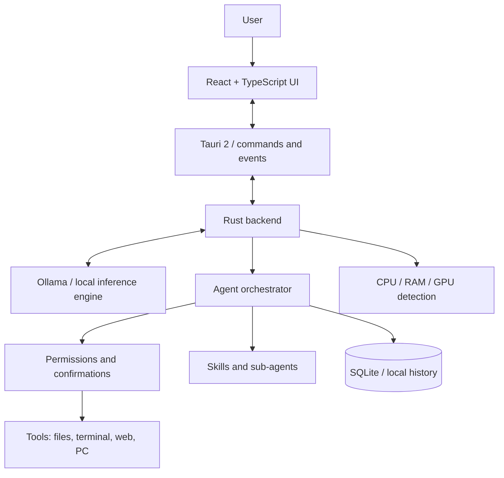

🌐 **Documentation languages**

🇬🇧 [English](README.md) | 🇫🇷 [Français](README_FR.md)

---
# ⚡ Local Agent

**The project's final name has not been chosen yet.** `local-agent` is its **temporary name**, currently used for the repository, source code, and development builds.

### Your computer. Your models. Your rules.

**An upcoming local-first, open-source desktop AI agent designed to do more than chat: understand tasks, use tools, and get work done, while keeping the user in control.**

[](LICENSE)
[](https://tauri.app/)
[](https://www.rust-lang.org/)
[](https://react.dev/)
[](https://ollama.com/)
[](#-project-status)

🌐 **Project website: [local-agent-website.vercel.app](https://local-agent-website.vercel.app)**

**[The vision](#-why-this-project) · [Examples](#-what-we-want-to-make-possible) · [Skills](#-skills-at-the-heart-of-the-experience) · [Getting started](#-developing-locally) · [Contributing](#-contributing) · [License](#-mit-license)**

> [!IMPORTANT]
> **This project is under active development.** The repository currently contains the foundations of a **Tauri 2 + React + TypeScript + Rust** application, **not yet a complete AI agent**. The Ollama integration, agent-operated terminal, skills, sub-agents, and PC control features described below are part of the **roadmap**, not a list of features already available.

---

## 🧠 What is this project?

Local Agent (temporary name) aims to bring together, in **one desktop application**, everything you'd expect from a truly useful local AI assistant:

- **A local model**, especially through [Ollama](https://ollama.com/), with no mandatory cloud subscription for inference.
- **Built-in tools** for working with files, folders, code, and a terminal.
- **Predefined skills**, included out of the box to guide the agent through specific tasks.
- **Multi-step tasks** and, eventually, collaborating sub-agents.
- **Clear resource management**: model selection based on hardware, particular attention to AMD GPUs, memory budgets, and monitoring.
- **A polished native desktop experience**, with streaming, history, progress indicators, change previews, and a Stop button.

The goal is **not** to build yet another chat window for Ollama. It's to create a workspace where a model can suggest a plan, request the right tools, analyze their results, and continue a task — **without being granted unrestricted access to the computer**.

## 💡 Why this project?

I started this project for one simple reason: **I couldn't find a single application that brought together exactly the features I wanted, already integrated and ready to use**.

There are excellent local AI chats, coding assistants, automation tools, and agent platforms. But getting *my* ideal experience often means combining several applications, choosing extensions, writing your own skills, or tweaking countless settings.

I want to try a different approach:

> **Don't make users turn an AI into a useful agent themselves. Give them an agent with the right tools, understandable skills, and explicit boundaries from day one.**

This is **not** a claim that existing projects lack tools or skills. Several already provide them. What I want to build is **my own combination**: local, native, consistent, ready to work, customizable, and mindful of hardware limitations.

### 🔭 Inspiring projects — and what they show

| Project | Examples of existing features | What Local Agent aims to emphasize |
|:--|:--|:--|
| [Open WebUI](https://docs.openwebui.com/features/) | Multi-model chat, web search, tools, Open Terminal, skills | A **native desktop experience** with organized, ready-to-use workflows and skills |
| [AnythingLLM](https://docs.anythingllm.com/installation-desktop/overview) | Desktop app, documents, agents, skills | An agent focused on **system actions, coding, and resource management** |
| [Jan](https://docs.jan.ai/desktop/quickstart) | Local models, projects, assistants, agents, MCP connectors | A **tools + model + permissions** setup that is as simple as possible |
| [Cline](https://github.com/cline/cline) | Code changes, commands, diffs, and checkpoints | Bring an agentic approach to **more desktop tasks**, not just coding |
| [Continue](https://docs.continue.dev/ide-extensions/agent/quick-start) | Coding agent, project exploration and editing | A standalone app with **custom-built skills and local model selection** |

These references help explain the ecosystem, **not to suggest their features are missing or inferior**. Local Agent is independent of these projects.

---

## ✨ What we want to build

| Area | Planned capabilities | Status |
|:--|:--|:--|
| 🧠 **Local AI** | Ollama connection, installed models, selection, and settings | 🔜 Planned |
| ⚡ **Streaming** | Progressive display of responses and actions, Stop button | 🔜 Planned |
| 📂 **Files** | Browse, read, search, compare, and suggest changes | 🔜 Planned |
| 💻 **Terminal** | Run approved tasks, stream output, cancel processes | 🔜 Planned |
| 🧩 **Skills** | Ready-to-use, customizable, version-controlled procedures | 🔜 Planned |
| 🔎 **Web search** | Multiple queries, inspected sources, summaries, and links | 🔜 Planned |
| 🤝 **Sub-agents** | Break down tasks, delegate, collect and verify results | 🔜 Planned |
| 🖥️ **PC interaction** | Actions in windows and applications with explicit permission | 🔭 To explore |
| 🎮 **AMD and other GPUs** | Hardware detection, tested compatibility, and fallback options | 🔜 Planned |
| 📊 **VRAM** | Model profiles, budgets, safety margins, metrics, and alerts | 🔭 To explore |
| 💾 **Local history** | Conversations, sessions, events, and tool results via SQLite | 🔜 Planned |
| 🪄 **Desktop application** | Native desktop window using React, TypeScript, Rust, and Tauri | ✅ Foundation in place |

**What we're not promising:** “zero bugs,” universal compatibility with every AMD GPU, or VRAM limits guaranteed down to the last byte. Those goals require real-world testing, compatible drivers, fallback mechanisms, and reproducible measurements.

## 🚀 What we want to make possible

The following requests are **target scenarios**, not demonstrations of features that have already been implemented.

### 01 — Debug a project

> “Open my React project, find out why TypeScript won't compile, suggest a fix, and then run the tests after I approve.”

**Planned tools:** file reading, code search, diff, terminal, error checking.

### 02 — Work with documents

> “Look through this folder, find the notes related to my presentation, and summarize them with references to the source files.”

**Planned tools:** folder selection, local indexing, extraction, and search.

### 03 — Research with sources

> “Compare these three Rust libraries using their official documentation. Cite the pages you used.”

**Planned tools:** web search, page retrieval, summaries, and citations. **Internet connection required.**

### 04 — Prepare a patch without touching the project

> “Inspect this repository, spot potential error-handling problems, and show me the changes you'd make. Don't apply them yet.”

**Planned tools:** read-only access, code analysis, change previews.

### 05 — Coordinate a task with multiple agents

> “Have one sub-agent investigate the bug, another propose a fix, then compare the results before making any changes.”

**Planned tools:** orchestrator, sub-agents, task memory, and approval flow.

### 06 — Adapt the model to the computer

> “I want to code while leaving enough VRAM for my other applications. Which models and settings would make sense on this machine?”

**Planned tools:** GPU detection, memory estimation, recommendations, and monitoring.

### 07 — Use the PC with human oversight

> “Open the application's settings and show me where to change this option. Ask me before doing anything that modifies my files.”

**Planned tools:** *explicitly enabled* UI automation, action previews, and an immediate stop mechanism.

### 08 — Make answers more consistent with skills

> “When researching on the web, always use the dedicated tool, separate verified information from assumptions, and provide source links.”

**Planned tools:** skill loading, structured tool calls, response validation.

---

## 🧩 Skills at the heart of the experience

**The idea:** a library of prepared capabilities so users don't have to rewrite lengthy instructions every time.

Examples of planned skills:

| Skill | Purpose |
|:--|:--|
| `web-search` | Search multiple queries and cite URLs actually visited |
| `code-review` | Read code, identify risks, and propose diffs |
| `project-debugging` | Reproduce a bug, inspect errors, and suggest a fix |
| `file-analysis` | Explore authorized folders and summarize documents |
| `terminal-assistant` | Prepare commands, explain their effects, and ask for confirmation |
| `dependency-check` | Check dependencies and flag potentially risky changes |
| `test-runner` | Select and interpret tests without hiding failures |
| `task-planner` | Break complex work into verifiable steps |

### Example: a future web-search skill

The following illustrates a `skills/web-search/SKILL.md` file. **The `web_search` tool does not yet exist in the application.**

````markdown
---
name: web-search
description: Search for recent information and cite sources that were actually consulted.
---

# Web search

Use this skill when a question requires recent or external information.

1. Turn the request into several focused searches.
2. Use the `web_search` tool with a list of queries.
3. Read the results and open relevant sources when needed.
4. Distinguish facts, assumptions, and unverified information.
5. Provide a clear summary and links to the sources used.
6. Never invent a result or citation.

Conceptual example of a tool call:

`web_search(["official Ollama documentation", "Ollama AMD GPU support"])`
````

The proposed format is inspired by the [open Agent Skills specification](https://github.com/agentskills/agentskills). **A skill guides the model; it does not grant system permissions or, on its own, guarantee that the model will follow instructions.** Permissions and validation will be enforced by the backend.

---

## 🏗️ Proposed architecture



**Core principle:** the AI **proposes**, the backend **verifies**, and the user **stays in control**. Text generated by the model or received from a web page or file must never be able to grant itself additional permissions.

### Tech stack

| Component | Choice | Status |
|:--|:--|:--|
| Desktop | [Tauri 2](https://tauri.app/) | Foundation in place |
| UI | [React](https://react.dev/), TypeScript, [Vite](https://vite.dev/) | Foundation in place |
| Backend | [Rust](https://www.rust-lang.org/) | Foundation in place |
| Local inference | [Ollama](https://docs.ollama.com/api) | Integration planned |
| Data | [SQLite](https://sqlite.org/) | Planned |
| Skills | Markdown + YAML | Planned |
| Extensible tools | [MCP](https://modelcontextprotocol.io/) | Under consideration |
| Alternative engine | [llama.cpp](https://github.com/ggml-org/llama.cpp) | Under consideration |

### Proposed project structure (not fully implemented)

```text
src/
  components/         # Chat, tools, panels, and permissions
  features/           # Conversations, models, settings
  lib/                # Calls to Tauri commands
src-tauri/src/
  agent/              # Task orchestration
  inference/          # Ollama communication
  storage/            # SQLite and migrations
  tools/              # Controlled tool execution
  system/             # System information
skills/
  web-search/
  code-review/
  project-debugging/
```

---

## 🚦 Project status

**Current version: `0.1.0` — foundations.** The GitHub repository still contains a Tauri demo interface and an example Rust command. Ollama integration, agent orchestration, and tools need to be built before Local Agent can function as an autonomous assistant.

### Roadmap

- [x] Initialize Tauri 2, React, TypeScript, and Rust.
- [x] Configure Windows desktop builds.
- [x] Publish the repository and adopt the MIT license.
- [ ] Replace the demo interface with the actual UI.
- [ ] Detect Ollama, list models, and check their availability.
- [ ] Build chat with streaming, persistence, and cancellation.
- [ ] Integrate SQLite for conversation history.
- [ ] Add file reading, search, and diffs.
- [ ] Add terminal commands controlled by permissions.
- [ ] Ship the first library of predefined skills.
- [ ] Add web search with sources.
- [ ] Develop GPU detection and model recommendations.
- [ ] Test AMD hardware configurations specifically.
- [ ] Add memory/VRAM monitoring and adaptive budgets.
- [ ] Experiment with sub-agents.
- [ ] Explore PC interaction and emergency-stop controls.
- [ ] Add automated tests and public releases.
- [ ] Choose the project's **final name**.

---

## 🛠️ Developing locally

> [!NOTE]
> These instructions run **the repository's current version**, not yet a working Ollama agent.

### Prerequisites

- Windows (the initial development priority).
- [Git](https://git-scm.com/), [Node.js](https://nodejs.org/), and [pnpm](https://pnpm.io/installation).
- [Rust](https://www.rust-lang.org/tools/install) and Cargo.
- The [official Tauri prerequisites for Windows](https://v2.tauri.app/start/prerequisites/): appropriate C++ build tools and WebView2.
- [Ollama](https://ollama.com/download) is **optional for now**, because integration has not been implemented yet.

### Clone the repository

```powershell
git clone https://github.com/CraftyPlayerYT/local-agent.git
cd local-agent
pnpm install
```

### Run the development build

```powershell
pnpm tauri dev
```

### Build the Windows application

```powershell
pnpm build
pnpm tauri build
```

Tauri build outputs are typically found in `src-tauri/target/release/`, with installers in `src-tauri/target/release/bundle/`.

### Basic checks before contributing

```powershell
pnpm build
cd src-tauri
cargo check
cargo test
```

These commands check compilation and run existing tests; they are not a replacement for the functional, security, and compatibility tests that still need to be added.

---

## 🤝 Contributing

**The repository is public and accepts issues, forks, and pull requests.** Whether you're a Rust developer, UI enthusiast, AMD user, skill author, or motivated beginner, concrete feedback is welcome.

### How to submit a change

1. Browse the [issues](https://github.com/CraftyPlayerYT/local-agent/issues), and describe your idea first if it involves a significant change.
2. [Fork the repository](https://github.com/CraftyPlayerYT/local-agent/fork).
3. Clone your fork and create a branch:

   ```powershell
   git clone https://github.com/YOUR-USERNAME/local-agent.git
   cd local-agent
   git switch -c feat/name-of-your-idea
   pnpm install
   ```

4. Update the code, document your changes, and run the relevant checks.
5. Push your work:

   ```powershell
   git add .
   git commit -m "feat: add a new feature"
   git push -u origin feat/name-of-your-idea
   ```

6. Open a [pull request](https://github.com/CraftyPlayerYT/local-agent/pulls) targeting `main`. Explain the problem, expected behavior, tests performed, and any new permissions required.

### Examples of first contributions

| Level | Idea | Why it helps |
|:--|:--|:--|
| 🟢 Beginner | Fix wording, translations, or empty states | Makes the app more accessible |
| 🟢 Beginner | Add a React component test | Helps prevent regressions |
| 🟡 Intermediate | Display installed Ollama models | Delivers the first concrete AI integration |
| 🟡 Intermediate | Build a diff preview panel | Makes changes easy to review |
| 🟡 Intermediate | Document a skill with test cases | Makes the agent more predictable |
| 🔴 Advanced | Build a queue of cancellable Rust tasks | Foundation for agents and sub-agents |
| 🔴 Advanced | Test and measure AMD VRAM usage | Improves real-world compatibility |
| 🔴 Advanced | Design per-tool permissions | Helps protect the user's computer |

**Contribution guidelines:** keep each PR focused; never commit secrets or personal data; justify any extended system access; don't automatically modify user files without an approval flow; and include reproducible tests for sensitive changes.

### Reporting a bug

When [opening an issue](https://github.com/CraftyPlayerYT/local-agent/issues/new), include the operating system, app version, AI model and GPU (if relevant), reproduction steps, expected result, actual result, and logs **with sensitive information removed** whenever possible.

---

## 🛡️ Security and privacy

Local does not automatically mean secure. An agent that can read files or execute commands needs clear boundaries.

**Development principles:**

- **Read-only by default** when exploring projects.
- **Explicit, scoped permissions** for writing files or using system tools.
- **Diffs and confirmations** before sensitive changes.
- **Task cancellation** and proper management of launched processes.
- **Readable action history** showing actions and results.
- **Treat external content as untrusted**, including web pages and analyzed files.
- **No data sent to external services without clear disclosure**, including web searches.

These safeguards are **goals to implement and test**: not all are active today.

---

## 📜 MIT license

The **source code in this repository** is distributed under the [MIT License](LICENSE).

Among other things, you may:

- ✅ use the code, including commercially;
- ✅ study, modify, and redistribute it;
- ✅ create a fork or derivative work;
- ✅ reuse portions of the code in a proprietary project.

You must retain **the copyright notice and license text** in copies or substantial portions of the software. The software is provided **without warranty**, as stated in the license.

**Important:** the MIT License does **not** require derivative projects to publish their source code. AI models, fonts, icons, plugins, and libraries may be subject to **their own licenses**. The repository's MIT License does not override those terms.

Contributions merged into this project are intended to be distributed under the repository's license. If you're unsure about third-party content or rights, open an issue before adding it.

---

## ❓ FAQ

**Will the project always be called Local Agent?**  
No. **The final name hasn't been chosen.** `local-agent` is the temporary name of the repository and the application under development.

**Does the application already work like Codex?**  
Not yet. The desktop foundation exists, but the agent loop and tools still need to be developed.

**Will it work without an Internet connection?**  
That's the goal for conversations using an already installed local model. Web searches, updates, and downloads will naturally require Internet access.

**Is it AMD-compatible?**  
AMD compatibility is a priority. It will need to be tested GPU by GPU and inference engine by inference engine. See the [Ollama GPU documentation](https://docs.ollama.com/gpu).

**Can I set an exact VRAM limit for each model?**  
The goal is to provide sensible budgets and safety margins. An absolute limit that is always respected on every driver is not guaranteed at this stage.

**Will tools and skills be included by default?**  
That's the ambition: to ship a cohesive set of useful tools and skills from the start, with options to customize or disable them.

**Can I use the source code in my own project?**  
Yes, under the terms of the [MIT License](LICENSE). Check model and dependency licenses separately.

---

## 🔗 Resources

- [Tauri — official documentation](https://v2.tauri.app/)
- [Ollama — official API](https://docs.ollama.com/api)
- [Ollama — GPU compatibility](https://docs.ollama.com/gpu)
- [Agent Skills — open specification](https://github.com/agentskills/agentskills)
- [GitHub — Markdown formatting](https://docs.github.com/en/get-started/writing-on-github/getting-started-with-writing-and-formatting-on-github/basic-writing-and-formatting-syntax)

---

### 🌍 Built in the open. Made to run locally.

**The name may change. The idea is already here: powerful, useful, controllable local AI.**

🌐 **[Website](https://local-agent-website.vercel.app)** · ⭐ **[Explore the repository](https://github.com/CraftyPlayerYT/local-agent)** · 🐛 **[Report a bug](https://github.com/CraftyPlayerYT/local-agent/issues)** · 🛠️ **[Contribute code](https://github.com/CraftyPlayerYT/local-agent/pulls)**

*An independent project, not affiliated with Ollama, Open WebUI, Jan, AnythingLLM, Cline, or Continue.*
