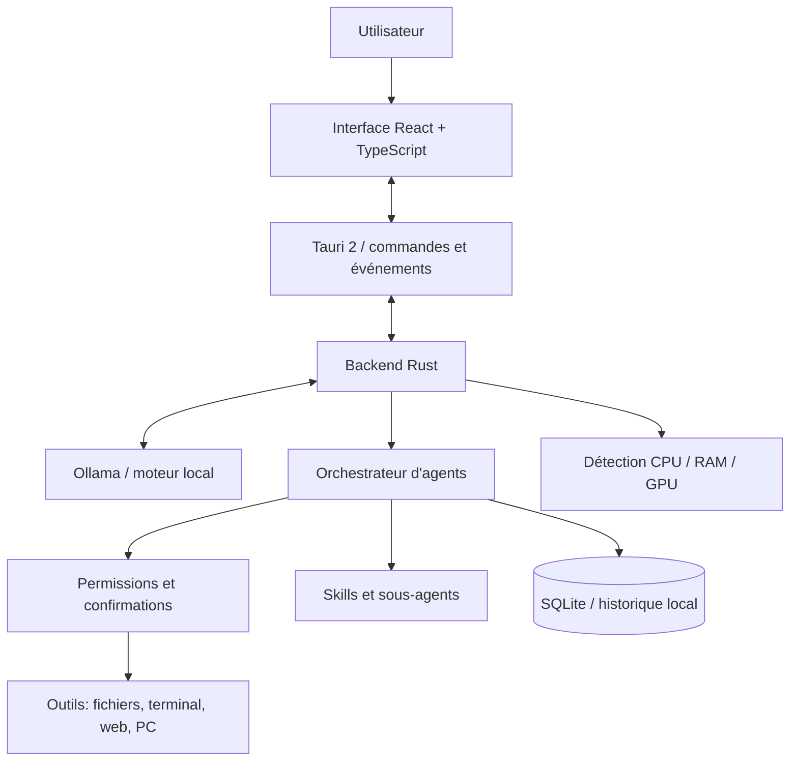

# ⚡ Local Agent

**Le nom définitif du projet n'est pas encore choisi.** `local-agent` est son **nom provisoire**, utilisé pour le dépôt, le code et les versions de développement.

### Your computer. Your models. Your rules.

**Un futur agent IA de bureau, local-first, open source et pensé pour faire plus que discuter : comprendre, utiliser des outils et accomplir des tâches, avec l'utilisateur aux commandes.**

[](LICENSE)
[](https://tauri.app/)
[](https://www.rust-lang.org/)
[](https://react.dev/)
[](https://ollama.com/)
[](#-état-du-projet)

🌐 **Site web du projet : [local-agent-website.vercel.app](https://local-agent-website.vercel.app)**

**[La vision](#-pourquoi-ce-projet) · [Exemples](#-ce-quon-veut-pouvoir-faire) · [Skills](#-les-skills-au-cœur-de-lexpérience) · [Installation](#-développer-en-local) · [Contribuer](#-contribuer) · [Licence](#-licence-mit)**

> [!IMPORTANT]
> **Projet en cours de construction.** Le dépôt contient actuellement les fondations d'une application **Tauri 2 + React + TypeScript + Rust**, pas encore un agent IA complet. Les fonctions Ollama, terminal agentique, skills, sous-agents et contrôle du PC présentées ci-dessous constituent la **feuille de route**, et non une liste de fonctions déjà disponibles.

---

## 🧠 C'est quoi, ce projet ?

Local Agent (nom provisoire) vise à réunir, dans **une seule application desktop**, ce qu'on attend d'un assistant IA local vraiment utile :

- **Un modèle local**, notamment via [Ollama](https://ollama.com/), sans abonnement cloud obligatoire pour l'inférence.
- **Des outils intégrés** pour travailler avec des fichiers, des dossiers, du code et un terminal.
- **Des skills prédéfinis**, fournis dès l'installation pour guider le comportement de l'agent dans des tâches précises.
- **Des tâches en plusieurs étapes** et, à terme, des sous-agents qui collaborent.
- **Un contrôle clair des ressources** : choix des modèles selon le matériel, attention particulière aux GPU AMD, budgets de mémoire et surveillance.
- **Une interface native soignée**, avec streaming, historique, progression, visualisation des changements et bouton d'arrêt.

L'objectif n'est **pas** de créer une énième fenêtre de chat pour Ollama. C'est de construire un espace de travail où le modèle peut proposer un plan, demander les bons outils, analyser les résultats et poursuivre une tâche — **sans recevoir pour autant des permissions illimitées sur le PC**.

## 💡 Pourquoi ce projet ?

J'ai lancé ce projet pour une raison simple : **je ne trouvais pas de logiciel qui réunisse exactement les fonctionnalités que je voulais, directement intégrées et prêtes à l'emploi**.

On trouve d'excellents chats locaux, assistants de code, outils d'automatisation et plateformes d'agents. Mais, pour obtenir *mon* expérience idéale, il faut souvent combiner plusieurs logiciels, choisir des extensions, créer ses propres skills ou ajuster de nombreux réglages.

Je veux essayer une autre approche :

> **Ne pas demander à l'utilisateur de transformer une IA en agent utile. Fournir, dès le départ, un agent avec des outils adaptés, des skills compréhensibles et des limites explicites.**

Ce n'est **pas** une affirmation selon laquelle aucun projet existant ne propose de tools ou de skills. Plusieurs le font déjà. Ce que je veux construire, c'est **ma propre combinaison** : locale, native, cohérente, prête à travailler, personnalisable et attentive aux contraintes matérielles.

### 🔭 Des projets inspirants — et ce qu'ils montrent

| Projet | Exemples de fonctionnalités existantes | Ce que Local Agent veut mettre au centre |
|:--|:--|:--|
| [Open WebUI](https://docs.openwebui.com/features/) | Chat multi-modèles, recherche web, outils, Open Terminal, skills | Une **expérience desktop native** avec des workflows et skills fournis et organisés dès le départ |
| [AnythingLLM](https://docs.anythingllm.com/installation-desktop/overview) | Application desktop, documents, agents, skills | Un agent orienté **actions système, programmation et gestion des ressources** |
| [Jan](https://docs.jan.ai/desktop/quickstart) | Modèles locaux, projets, assistants, agents, connecteurs MCP | Un parcours **outils + modèle + permissions** aussi simple que possible |
| [Cline](https://github.com/cline/cline) | Modifications de code, commandes, diffs et checkpoints | Étendre l'approche agentique à **plusieurs tâches desktop**, pas seulement au code |
| [Continue](https://docs.continue.dev/ide-extensions/agent/quick-start) | Agent de code, exploration et modification de projets | Une application autonome avec **skills maison et sélection de modèles locaux** |

Ces références servent à comprendre l'écosystème, **pas à prétendre que leurs fonctionnalités sont absentes ou inférieures**. Local Agent est indépendant de ces projets.

---

## ✨ Ce qu'on veut construire

| Domaine | Fonctionnalités visées | Statut |
|:--|:--|:--|
| 🧠 **IA locale** | Connexion à Ollama, modèles installés, sélection et paramètres | 🔜 Prévu |
| ⚡ **Streaming** | Affichage progressif des réponses et des actions, bouton Stop | 🔜 Prévu |
| 📂 **Fichiers** | Parcourir, lire, rechercher, comparer et proposer des modifications | 🔜 Prévu |
| 💻 **Terminal** | Exécuter des tâches autorisées, suivre les sorties, annuler les processus | 🔜 Prévu |
| 🧩 **Skills** | Procédures prêtes à l'emploi, personnalisables et versionnées | 🔜 Prévu |
| 🔎 **Recherche web** | Plusieurs requêtes, sources consultées, synthèses et liens | 🔜 Prévu |
| 🤝 **Sous-agents** | Décomposer les tâches, déléguer, collecter et vérifier les résultats | 🔜 Prévu |
| 🖥️ **Interaction PC** | Actions sur des fenêtres et applications avec autorisation explicite | 🔭 À étudier |
| 🎮 **AMD et autres GPU** | Détection de matériel, compatibilité testée et chemins de repli | 🔜 Prévu |
| 📊 **VRAM** | Profils de modèles, budgets, marges, mesures et alertes | 🔭 À étudier |
| 💾 **Historique local** | Conversations, sessions, événements et résultats d'outils via SQLite | 🔜 Prévu |
| 🪄 **Application desktop** | Fenêtre native avec React, TypeScript, Rust et Tauri | ✅ Base existante |

**Ce qu'on ne promet pas :** « zéro bug », une compatibilité absolue avec tous les GPU AMD ou une limite de VRAM garantie à l'octet près. Ce sont des sujets qui nécessitent des tests réels, des pilotes compatibles, des mécanismes de repli et des mesures reproductibles.

## 🚀 Ce qu'on veut pouvoir faire

Les demandes suivantes sont **des scénarios cibles**, pas des démonstrations de fonctions déjà implémentées.

### 01 — Déboguer un projet

> « Ouvre mon projet React, identifie pourquoi TypeScript ne compile pas, propose un correctif, puis lance les tests après mon accord. »

**Outils envisagés :** lecture de fichiers, recherche dans le code, diff, terminal, vérification des erreurs.

### 02 — Travailler avec des documents

> « Parcours ce dossier, retrouve les notes liées à mon exposé et fais-moi un résumé avec les fichiers sources. »

**Outils envisagés :** sélection de dossier, indexation locale, extraction et recherche.

### 03 — Faire une recherche documentée

> « Compare ces trois bibliothèques Rust en consultant leur documentation officielle. Cite les pages utilisées. »

**Outils envisagés :** recherche web, consultation des pages, synthèse et citations. **Connexion Internet requise.**

### 04 — Préparer un patch sans toucher au projet

> « Inspecte ce dépôt, repère les problèmes de gestion d'erreurs et montre-moi les changements que tu ferais. Ne les applique pas encore. »

**Outils envisagés :** lecture seule, analyse de code, aperçu des modifications.

### 05 — Organiser une tâche avec plusieurs agents

> « Analyse le bug avec un sous-agent, fais proposer un correctif à un autre, puis compare les résultats avant toute modification. »

**Outils envisagés :** orchestrateur, sous-agents, mémoire de tâches et validation.

### 06 — Adapter le modèle au PC

> « Je veux coder tout en gardant suffisamment de VRAM pour mes autres applications. Quels modèles et réglages sont raisonnables sur cette machine ? »

**Outils envisagés :** détection GPU, estimation de mémoire, recommandations et surveillance.

### 07 — Utiliser le PC avec contrôle humain

> « Ouvre les paramètres de l'application et montre-moi où modifier cette option. Demande-moi avant toute action qui change mes fichiers. »

**Outils envisagés :** automatisation d'interface *explicitement activée*, aperçu de l'action et arrêt immédiat.

### 08 — Rendre les réponses cohérentes grâce aux skills

> « Pour les recherches web, utilise toujours l'outil dédié, distingue les informations vérifiées des hypothèses et donne les liens des sources. »

**Outils envisagés :** chargement de skills, appels d'outils structurés, validation des réponses.

---

## 🧩 Les skills au cœur de l'expérience

**L'idée :** une bibliothèque de compétences préparées pour éviter que l'utilisateur doive réécrire à chaque fois de longues instructions.

Exemples de skills envisagés :

| Skill | Rôle |
|:--|:--|
| `web-search` | Rechercher plusieurs mots-clés et citer les URL réellement consultées |
| `code-review` | Lire le code, identifier les risques et proposer des diffs |
| `project-debugging` | Reproduire un bug, examiner les messages d'erreur, proposer un correctif |
| `file-analysis` | Explorer des dossiers autorisés et synthétiser des documents |
| `terminal-assistant` | Préparer des commandes, expliquer leurs effets et demander confirmation |
| `dependency-check` | Vérifier les dépendances et signaler les changements à risque |
| `test-runner` | Sélectionner et interpréter des tests sans masquer les échecs |
| `task-planner` | Découper les travaux complexes en étapes vérifiables |

### Exemple : un futur skill de recherche web

L'exemple suivant illustre un fichier `skills/web-search/SKILL.md`. **L'outil `web_search` n'existe pas encore dans l'application.**

````markdown
---
name: web-search
description: Rechercher des informations récentes et citer les sources réellement consultées.
---

# Recherche web

Utilise ce skill quand une question demande des informations récentes ou externes.

1. Transforme la demande en plusieurs recherches ciblées.
2. Utilise l'outil `web_search` avec une liste de requêtes.
3. Lis les résultats et ouvre les sources pertinentes quand c'est nécessaire.
4. Distingue faits, hypothèses et informations non vérifiées.
5. Fournis une synthèse claire et les liens des sources utilisées.
6. N'invente jamais un résultat ou une citation.

Exemple conceptuel d'appel :

`web_search(["documentation officielle Ollama", "support GPU AMD Ollama"])`
````

Le format envisagé s'inspire de la [spécification ouverte Agent Skills](https://github.com/agentskills/agentskills). **Un skill guide le modèle ; il ne constitue pas une autorisation système et ne garantit pas à lui seul le respect des consignes.** Les droits et validations seront gérés par le backend.

---

## 🏗️ Architecture envisagée



**Règle centrale :** l'IA **propose**, le backend **vérifie** et l'utilisateur **garde le contrôle**. Un texte généré par le modèle, par une page web ou par un fichier ne doit jamais pouvoir donner de nouvelles permissions à lui seul.

### Stack

| Composant | Choix | Statut |
|:--|:--|:--|
| Desktop | [Tauri 2](https://tauri.app/) | Base en place |
| UI | [React](https://react.dev/), TypeScript, [Vite](https://vite.dev/) | Base en place |
| Backend | [Rust](https://www.rust-lang.org/) | Base en place |
| Moteur local | [Ollama](https://docs.ollama.com/api) | Intégration prévue |
| Données | [SQLite](https://sqlite.org/) | Prévu |
| Skills | Markdown + YAML | Prévu |
| Outils extensibles | [MCP](https://modelcontextprotocol.io/) | Envisagé |
| Moteur alternatif | [llama.cpp](https://github.com/ggml-org/llama.cpp) | Envisagé |

### Organisation de code proposée (non présente intégralement)

```text
src/
  components/         # Chat, outils, panneaux et permissions
  features/           # Conversations, modèles, paramètres
  lib/                # Appels des commandes Tauri
src-tauri/src/
  agent/              # Orchestration des tâches
  inference/          # Communication avec Ollama
  storage/            # SQLite et migrations
  tools/              # Exécution contrôlée des outils
  system/             # Informations machine
skills/
  web-search/
  code-review/
  project-debugging/
```

---

## 🚦 État du projet

**Version actuelle : `0.1.0` — fondations.** Le dépôt GitHub comporte encore une interface de démonstration Tauri et une commande Rust d'exemple. Il faut construire l'intégration Ollama, l'orchestrateur et les outils avant de pouvoir utiliser Local Agent comme assistant autonome.

### Roadmap

- [x] Initialiser Tauri 2, React, TypeScript et Rust.
- [x] Configurer le build desktop Windows.
- [x] Publier le dépôt public et adopter la licence MIT.
- [ ] Remplacer l'interface de démonstration par le véritable UI.
- [ ] Détecter Ollama, lister les modèles et vérifier leur disponibilité.
- [ ] Créer le chat avec streaming, sauvegarde et annulation.
- [ ] Intégrer SQLite pour l'historique des conversations.
- [ ] Ajouter la lecture de fichiers, la recherche et les diffs.
- [ ] Ajouter des commandes de terminal soumises à des permissions.
- [ ] Livrer une première bibliothèque de skills prédéfinis.
- [ ] Ajouter la recherche web avec sources.
- [ ] Développer la détection GPU et les recommandations de modèles.
- [ ] Tester spécifiquement les configurations AMD.
- [ ] Ajouter le suivi mémoire/VRAM et les budgets adaptatifs.
- [ ] Expérimenter les sous-agents.
- [ ] Étudier les interactions avec le PC et les contrôles d'arrêt.
- [ ] Ajouter les tests automatiques et les releases publiques.
- [ ] Choisir le **nom définitif** du projet.

---

## 🛠️ Développer en local

> [!NOTE]
> Ces étapes permettent de lancer **la version actuelle du dépôt**, pas encore un agent Ollama opérationnel.

### Prérequis

- Windows (plateforme prioritaire pour le développement initial).
- [Git](https://git-scm.com/), [Node.js](https://nodejs.org/) et [pnpm](https://pnpm.io/installation).
- [Rust](https://www.rust-lang.org/tools/install) et Cargo.
- Les [prérequis officiels Tauri sous Windows](https://v2.tauri.app/start/prerequisites/) : outils C++ adaptés et WebView2.
- [Ollama](https://ollama.com/download) est **facultatif pour le moment**, car l'intégration n'est pas encore implémentée.

### Cloner le dépôt

```powershell
git clone https://github.com/CraftyPlayerYT/local-agent.git
cd local-agent
pnpm install
```

### Lancer la version de développement

```powershell
pnpm tauri dev
```

### Construire l'application Windows

```powershell
pnpm build
pnpm tauri build
```

Les builds Tauri se trouvent généralement dans `src-tauri/target/release/` et les installateurs dans `src-tauri/target/release/bundle/`.

### Tests de base avant une contribution

```powershell
pnpm build
cd src-tauri
cargo check
cargo test
```

Ces commandes vérifient la compilation et exécutent les tests existants ; elles ne remplacent pas les tests fonctionnels, de sécurité et de compatibilité à venir.

---

## 🤝 Contribuer

**Le dépôt est public et accepte les issues, forks et pull requests.** Développeur Rust, fan d'interfaces, utilisateur AMD, auteur de skills ou débutant motivé : les retours concrets sont utiles.

### Comment proposer une modification

1. Consulte les [issues](https://github.com/CraftyPlayerYT/local-agent/issues), puis décris ton idée si elle demande un changement important.
2. Crée un [fork](https://github.com/CraftyPlayerYT/local-agent/fork).
3. Clone ton fork et crée une branche :

   ```powershell
   git clone https://github.com/VOTRE-PSEUDO/local-agent.git
   cd local-agent
   git switch -c feat/nom-de-votre-idee
   pnpm install
   ```

4. Modifie le code, documente les changements et exécute les vérifications utiles.
5. Publie ton travail :

   ```powershell
   git add .
   git commit -m "feat: ajouter une fonctionnalité"
   git push -u origin feat/nom-de-votre-idee
   ```

6. Ouvre une [pull request](https://github.com/CraftyPlayerYT/local-agent/pulls) vers `main`. Explique le besoin, le comportement, les tests et les éventuelles permissions supplémentaires.

### Exemples de premières contributions

| Niveau | Idée | Pourquoi c'est utile |
|:--|:--|:--|
| 🟢 Débutant | Corriger un texte, une traduction ou un état vide | Rend l'application plus accessible |
| 🟢 Débutant | Ajouter un test de composant React | Évite des régressions |
| 🟡 Intermédiaire | Ajouter l'affichage des modèles Ollama | Première intégration IA concrète |
| 🟡 Intermédiaire | Construire un panneau de diff | Rend les modifications vérifiables |
| 🟡 Intermédiaire | Documenter un skill avec cas de test | Rend l'agent plus prévisible |
| 🔴 Avancé | Construire une file de tâches Rust annulables | Base des agents et sous-agents |
| 🔴 Avancé | Tester et mesurer la consommation VRAM AMD | Améliore la compatibilité réelle |
| 🔴 Avancé | Concevoir un système de permissions par outil | Protège le poste utilisateur |

**Règles pour contribuer :** une PR par objectif cohérent ; aucun secret ni donnée personnelle dans les commits ; pas d'accès système étendu sans justification ; pas de modification automatique de fichiers sans flux de validation ; et des tests reproductibles pour tout changement sensible.

### Signaler un bug

Dans une [nouvelle issue](https://github.com/CraftyPlayerYT/local-agent/issues/new), indique si possible le système d'exploitation, la version de l'application, le modèle et le GPU (si concernés), les étapes pour reproduire, le résultat attendu, le résultat réel et les logs **sans informations sensibles**.

---

## 🛡️ Sécurité et confidentialité

Local ne veut pas dire automatiquement sûr. Un agent qui peut lire des fichiers ou lancer des commandes doit avoir des limites claires.

**Principes de développement :**

- **Lecture seule par défaut** pour l'exploration des projets.
- **Permissions explicites et ciblées** pour écrire des fichiers ou utiliser des outils système.
- **Diffs et confirmations** avant les changements sensibles.
- **Arrêt des tâches** et gestion des processus lancés.
- **Historique lisible** des actions et de leurs résultats.
- **Données externes considérées comme non fiables**, y compris pages web et fichiers analysés.
- **Aucun envoi de données vers un service externe sans indication claire**, y compris pour la recherche web.

Ces protections sont **des objectifs à implémenter et à tester** : elles ne sont pas toutes actives aujourd'hui.

---

## 📜 Licence MIT

Le **code de ce dépôt** est distribué sous [licence MIT](LICENSE).

Tu peux notamment :

- ✅ utiliser le code, y compris commercialement ;
- ✅ l'étudier, le modifier et le redistribuer ;
- ✅ créer un fork ou une version dérivée ;
- ✅ réutiliser des parties du code dans un projet propriétaire.

Tu dois conserver **la notice de copyright et le texte de licence** dans les copies ou parties substantielles du logiciel. Le logiciel est fourni **sans garantie**, conformément à la licence.

**Important :** la licence MIT n'oblige **pas** les projets dérivés à publier leur code source. Les modèles IA, polices, icônes, plugins et bibliothèques utilisés peuvent avoir **leurs propres licences**. La licence du dépôt ne remplace pas ces conditions.

Les contributions intégrées au projet sont destinées à être distribuées sous la licence du dépôt. Pour toute question sur des éléments tiers ou leurs droits, ouvre une issue avant de les ajouter.

---

## ❓ FAQ

**Le projet s'appellera-t-il définitivement Local Agent ?**  
Non. **Le nom final n'est pas choisi.** `local-agent` est le nom provisoire du dépôt et de l'application en développement.

**Est-ce que l'application fonctionne déjà comme Codex ?**  
Pas encore. Le socle desktop existe, mais la boucle agentique et les outils restent à développer.

**Est-ce que ça fonctionne sans Internet ?**  
C'est l'objectif pour les conversations avec un modèle local déjà installé. La recherche web, les mises à jour et les téléchargements auront évidemment besoin d'Internet.

**Est-ce compatible AMD ?**  
La compatibilité AMD est une priorité. Elle devra être mesurée carte par carte, moteur par moteur. Voir la [documentation GPU d'Ollama](https://docs.ollama.com/gpu).

**Peut-on limiter précisément la VRAM de chaque modèle ?**  
L'objectif est de proposer des budgets et des marges adaptés. Une limite absolue, respectée dans tous les cas et sur tous les pilotes, n'est pas garantie à ce stade.

**Les fonctionnalités et skills seront-ils intégrés d'office ?**  
C'est l'ambition du projet : proposer un ensemble cohérent de skills et d'outils utiles dès l'installation, avec la possibilité de les personnaliser et de les désactiver.

**Puis-je utiliser le code dans mon propre projet ?**  
Oui, selon les conditions de la [licence MIT](LICENSE). Vérifie séparément les licences des modèles et des dépendances.

---

## 🔗 Ressources

- [Tauri — documentation officielle](https://v2.tauri.app/)
- [Ollama — API officielle](https://docs.ollama.com/api)
- [Ollama — compatibilité GPU](https://docs.ollama.com/gpu)
- [Agent Skills — spécification ouverte](https://github.com/agentskills/agentskills)
- [GitHub — écrire du Markdown](https://docs.github.com/en/get-started/writing-on-github/getting-started-with-writing-and-formatting-on-github/basic-writing-and-formatting-syntax)

---

### 🌍 Built in the open. Made to run locally.

**Le nom peut encore changer. L'idée, elle, est déjà là : une IA locale puissante, utile et contrôlable.**

🌐 **[Site web](https://local-agent-website.vercel.app)** · ⭐ **[Découvrir le dépôt](https://github.com/CraftyPlayerYT/local-agent)** · 🐛 **[Signaler un bug](https://github.com/CraftyPlayerYT/local-agent/issues)** · 🛠️ **[Proposer du code](https://github.com/CraftyPlayerYT/local-agent/pulls)**

*Projet indépendant, non affilié à Ollama, Open WebUI, Jan, AnythingLLM, Cline ou Continue.*
